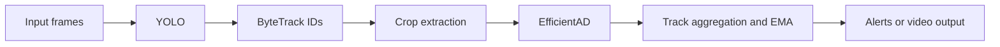

# Architecture

1. **YOLO detection** locates pieces without making the anomaly decision.
2. **ByteTrack** keeps persistent IDs between frames.
3. **Object preprocessing** extracts filtered, padded/resized RGB crops.
4. **EfficientAD** computes anomaly evidence using a teacher/student and an autoencoder.
5. **Temporal inference** smooths or aggregates scores (including EMA and persistence) per track.
6. **Rendering and reporting** produces inspection outputs outside this source-only repository.

The fast-v2 implementation runs *three phases*: cache detection/tracking, batched EfficientAD inference, then render results. This measures compute throughput separately from rendering; it does not demonstrate a live low-latency streaming system.

**Scoring equivalence:** moving between OpenCV and PIL crop backends, changing resolution or applying denoising can change model inputs and score distributions. Recalibrate operating thresholds when preprocessing changes.
